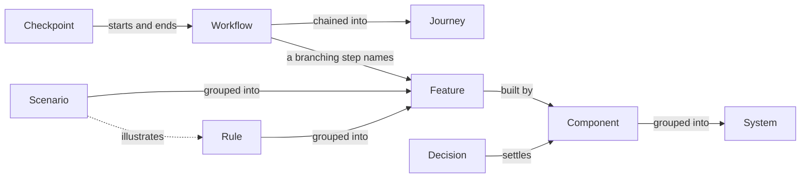

# Context Driven Development — Foundations

Every role reads this first. The rest is read by need.
- [Context Driven Development — Foundations](#context-driven-development--foundations)
  - [What](#what)
  - [Why](#why)
  - [Who](#who)
  - [Where](#where)
  - [How](#how)

## What

How a team of people and agents turn a customer's feedback into
a plan that delivers a product and learns from each cycle.

| Term | Meaning | Form | Naming |
|---|---|---|---|
| Form | A defined structure in English. Each form fits a different scope or zoom | — | Its name carries no commas or colons |
| Journey | What many users do together to reach a checkpoint | Numbered steps that chain workflows with the checkpoint each leaves | For what travels from start to end |
| Workflow | What one user role does to reach a checkpoint | Numbered steps from a Start checkpoint to an End. Each step names its act and the outcome that holds however it goes. A step that can go more than one way links its one feature in brackets | By a verb phrase |
| Checkpoint | A state of the work that one workflow leaves and the next starts from. Usually a handoff between roles | A row in a table of checkpoints | For how the work stands |
| Scenario | One way a workflow step can go, so a step has one or more. It illustrates a rule | [Gherkin](https://cucumber.io/docs/gherkin/reference) Given, When and Then in 3 to 5 steps. A Scenario Outline holds its cases as Examples rows, three at least | By a sentence of the case and what follows |
| Feature | Scenarios grouped by shared context | One Gherkin `Feature`. Its Background holds the shared context. Its scenarios sit directly under it or under a Rule | By a verb phrase for what happens at the fork |
| Rule | One fact a feature's scenarios illustrate. Optional | A Gherkin `Rule` holding the scenarios that illustrate it, two at least | By the fact as a sentence |
| Decision | How one part is built | One or two sentences in the architecture under the system or component they settle. One that's hard to undo carries a why footnote that names the options it beat | By its subject, in bold at the sentence's start |
| Component | One part that gets built | A heading under its system that holds its decisions. Its opening line names each design feature it builds. Features are the only way the architecture names the design | By a noun for what it does |
| System | Components grouped by what they run on | A section of the architecture | By a noun for what its components run on |
| Phase | One cycle of plan, deliver, and learn over a set of tickets | A goal in the roadmap | — |
| Plan | What a phase or an ad hoc blocker signs off before building. Its goal and design and architecture and tickets. The retro measures delivery against it | A snapshot of those docs at sign-off | — |
| Ticket | One part of a plan small enough to deliver and review alone | Acceptance criteria that name its feature's scenarios and an estimate in Fibonacci points and a model | For its feature. A ticket of steps alone takes its workflow's name |
| Retro | What a cycle learned. The phase's close reads it | A file per cycle | — |

## Why

Make the team's workflow something agents can run and people can read, so
the work goes to plan with no surprises.

The goal is zero feedback. The owner's review and the code review both find
nothing. A finding that matters is a planning miss, and the retro names the
doc that should have caught it. Token cost counts beside feedback.

Three ethics (borrowed from permaculture) are used to score choices.

| Ethic | Means |
|---|---|
| People care | Customers and the team come first. Their time and attention and way of working lead. Users drive the design through their journeys and workflows. Plain words a five-year-old could follow, which people and agents read alike |
| Repo care | Tend everything written in the repo so it stays healthy. That means the code and the `.md` files beside it. Tested and readable with each fact in one place. Where says where. A fact carried between checkpoints lives in the repo where it's reviewed. A user's or agent's memory holds none |
| Fair share | Take only what's needed. That means tokens and context and the users' time. Return the surplus as learning to the next cycle |

## Who

Users have accountabilities and responsibilities. A Role is a group of those. Agents can be used to help for any role.

| Role | Hands over | Reads | Accountable for |
|---|---|---|---|
| **Customer** | Feedback on what shipped | The product | — |
| **Product Owner** (the owner) | What's next and sign-off | The retros and the roadmap | The foundations and the roadmap |
| **Designer** | What to build and why | The roadmap's phase and the design | The design |
| **Developer** | How it's built. Working and tested code | The design and the architecture. Or a ticket and the sections it names | The architecture, the tickets and the code |
| **Agent** | Plays any role. The person in that role stays accountable | What its role reads | — |

## Where

Journeys say when. Each doc answers one question.

| Doc | Answers |
|---|---|
| design_document.md | What does the product need and why? |
| architecture.md | How is it built? |
| code | What runs? |
| product_roadmap.md | What's next? |
| deferred | What did we choose to leave for later? |
| ticket | What gets built in one session? |
| backlog/README.md | In what order do the tickets run? |
| release playbook | How does a change ship? |
| Feedback | What came up with the customer and the owner? |
| Retro | What did a cycle learn? |

## How

How the team works. The architecture holds how it's built.

| Principle | Means |
|---|---|
| The tortoise and the hare | Small and slow solutions.  An operation matures with time and nothing substitutes for it |
| Wide then deep | Draft every instance of a form roughly. Then review each one in depth with the user. Walk two or three real cases through it with a verdict for each. The wide draft shows where a redesign upstream would simplify. Each deep review ends by merging up the chain |
| Design from patterns to details | Analyze what happened to find the patterns that structure what comes next |
| Testability shapes the plan | Structured prose shows how to test it in the forms under What |
| Merge up the chain | Ask whether rules merge into one. Ask whether a rule is a scenario's outcome and whether a scenario is a workflow's step. Each merge goes to the owner with what it replaces |
| Facts flow down stream | A doc names only the docs above it. A ticket pulls part of the stream together to build the code. Feedback and retros feed the next cycle. Ask whether facts merge upstream during review. |
| Soft caps | Each form has a soft cap. A form past its cap calls for a redesign upstream and the user decides. The retros tune the caps |
| Score the options | Score each option put to the owner against the ethics and principles the choice touches as each role reads them. The top total is the pick. Walk real cases through it |
