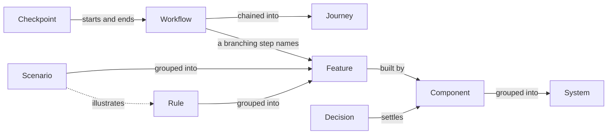

# Forms

The forms every app's docs take. Each app's foundations say what it makes with them.

| Term | Meaning | Form | Naming |
|---|---|---|---|
| Form | A defined structure in English. Each form fits a different scope or zoom | — | Its name carries no commas or colons |
| Journey | What many users do together to reach a checkpoint | Numbered steps that chain workflows with the checkpoint each leaves | For what travels from start to end |
| Workflow | What one user role does to reach a checkpoint | Numbered steps from a Start checkpoint to an End. Each step names its act and the outcome that holds however it goes. A step that can go more than one way links its one feature in brackets | By a verb phrase |
| Checkpoint | A state of the work that one workflow leaves and the next starts from. Usually a handoff between roles | A row in a table of checkpoints | For how the work stands |
| Scenario | One way a workflow step can go, so a step has one or more. It illustrates a rule | [Gherkin](https://cucumber.io/docs/gherkin/reference) Given, When and Then in 3 to 5 steps. A Scenario Outline holds its cases as Examples rows, three at least | By a sentence of the case and what follows |
| Feature | Scenarios grouped by shared context | One Gherkin `Feature`. Its Background holds the shared context. Its scenarios sit directly under it or under a Rule | By a verb phrase for what happens at the fork |
| Rule | One fact a feature's scenarios illustrate. Optional | A Gherkin `Rule` holding the scenarios that illustrate it, two at least | By the fact as a sentence |
| Decision | How one part is built | One or two sentences in the architecture under the system or component they settle. They state one fact. Its cases, if any, sit in a table under it, and its test runs each row. One that's hard to undo carries a why footnote that names the options it beat | By its subject, in bold at the sentence's start |
| Component | One part that gets built | A heading under its system that holds its decisions. Its opening line names each design feature it builds. Features are the only way the architecture names the design | By a noun for what it does |
| System | Components grouped by what they run on | A section of the architecture | By a noun for what its components run on |
| Phase | One cycle of plan, deliver, and learn over a set of tickets | A goal in the roadmap | — |
| Plan | What a phase or an ad hoc blocker signs off before building. Its goal and design and architecture and tickets. The retro measures delivery against it | A snapshot of those docs at sign-off | — |
| Ticket | One part of a plan small enough to deliver and review alone | Acceptance criteria that name its feature's scenarios and its decisions and an estimate in Fibonacci points and a model | For its feature. A ticket of steps alone takes its workflow's name |
| Retro | What a cycle learned. The phase's close reads it | A file per cycle | — |

